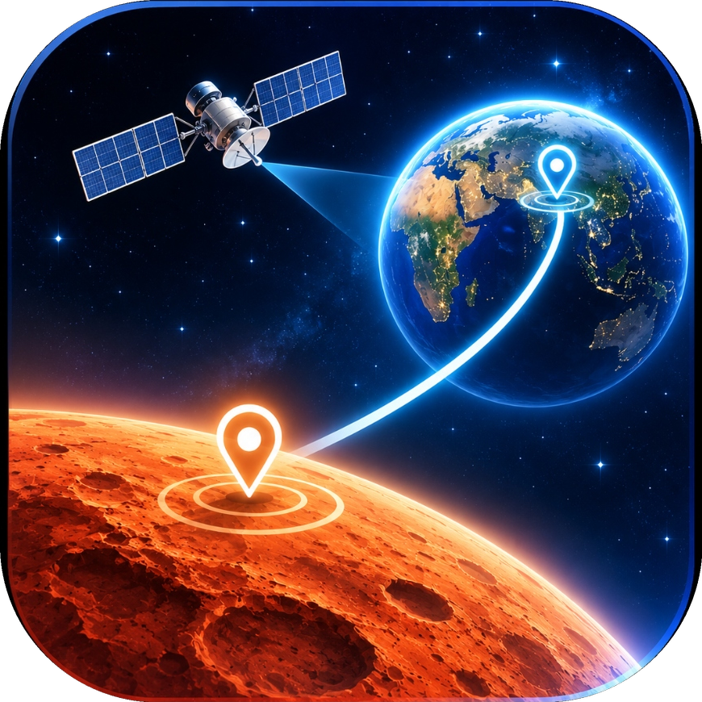

# 🪐 TERRATWIN
### 🚀 AI-Powered Earth Analog Discovery Platform for Lunar and Martian Exploration
#### *Planetary Analog Discovery Engine*

<p align="center">
  
</p>

<p align="center">
  <a href="#-project-overview"></a>
  <a href="#-tech-stack"></a>
  <a href="#-ai-mission-research-assistant--groq-llm"></a>
  <a href="#-data-and-scientific-sources"></a>
</p>

---

## 📖 Table of Contents
- [🌌 Project Overview](#-project-overview)
- [🎬 Video Glimpse](#-video-glimpse)
- [🌟 Key Features](#-key-features)
  - [🪐 1. Interactive 3D Planetary Explorer](#1--interactive-3d-planetary-explorer)
  - [🔍 2. Planetary-to-Terrestrial Analog Discovery](#2--planetary-to-terrestrial-analog-discovery)
  - [🌐 3. Synchronized 3D Side-by-Side Comparison](#3--synchronized-3d-side-by-side-comparison)
  - [📊 4. Morphometric Congruence & Elevation Profiles](#4--morphometric-congruence--elevation-profiles)
  - [🤖 5. AI Mission Research Assistant & Groq LLM](#5--ai-mission-research-assistant--groq-llm)
  - [📄 6. Publication-Grade PDF Research Report Generator](#6--publication-grade-pdf-research-report-generator)
  - [📚 7. Integrated Scientific Dataset Catalogue](#7--integrated-scientific-dataset-catalogue)
- [📸 Visual Glimpses & Walkthrough](#-visual-glimpses--walkthrough)
- [🧮 Comparison Algorithm & Mathematical Formulation](#-comparison-algorithm--mathematical-formulation)
  - [📐 1. Feature Space Representation](#1-feature-space-representation)
  - [📏 2. Multi-Dimensional Z-Score Standardization](#2-multi-dimensional-z-score-standardization)
  - [🪨 3. Petrological Compatibility Matrix](#3-petrological-compatibility-matrix)
  - [🎯 4. Multi-Criteria Weighted Distance](#4-multi-criteria-weighted-distance)
  - [📈 5. Exponential Congruence Mapping](#5-exponential-congruence-mapping)
  - [⛰️ 6. Terrain Ruggedness Index (TRI) & Slope Extraction](#6-terrain-ruggedness-index-tri--slope-extraction)
- [🛠️ Tech Stack](#️-tech-stack)
- [🛰️ Data and Scientific Sources](#️-data-and-scientific-sources)
- [⚙️ System Implementation & Architecture](#️-system-implementation--architecture)
- [📂 Project Structure](#-project-structure)
- [📑 Publication-Grade Research Reports](#-publication-grade-research-reports)
- [💻 How to Run](#-how-to-run)
  - [📋 Prerequisites](#prerequisites)
  - [🐍 Backend Setup](#1-backend-setup)
  - [⚛️ Frontend Setup](#2-frontend-setup)
  - [🚀 Integrated Production Build](#3-integrated-production-build)
- [🧪 Automated Test Suite](#-automated-test-suite)
- [🔮 Future Scope & Roadmap](#-future-scope--roadmap)
- [⚖️ Scientific Limitations & Disclaimers](#️-scientific-limitations--disclaimers)

---

## 🌌 Project Overview

Space exploration missions to the **Moon** and **Mars** demand rigorous terrestrial testing of rovers, robotic drills, spacesuits, sampling mechanisms, and optical payloads prior to launch. Historically, planetary scientists have selected terrestrial analog test sites through ad-hoc field experience or isolated geological surveys.

**TerraTwin** bridges planetary science and terrestrial geomorphology by providing an automated, mathematically rigorous, and physically grounded **Planetary Analog Discovery Engine**.

The system answers the fundamental NASA mission question:
> *"Which geographical locations on Earth most closely resemble a selected region of the Moon or Mars in terms of measurable surface, geological, and environmental characteristics — and for which specific scientific mission objectives is that resemblance valid?"*

### 🎯 Core Mission Goals:
- 🛰️ **Democratize Extraterrestrial Field Research**: Enable mission planners and planetary researchers to identify optimal field sites across all 7 continents without manual spatial querying.
- 📐 **Rigorous Quantitative Compatibility**: Eliminate qualitative guesswork by comparing multidimensional feature vectors across topography, petrology, diurnal thermal amplitude, and surface optical properties.
- 🤖 **Physics-Grounded AI Mission Synthesis**: Synthesize domain-specific operational evaluations for rover mobility, drilling terramechanics, and radiometer calibrations using state-of-the-art Large Language Models grounded in physical telemetry.
- 📄 **Publication-Ready Research Outputs**: Deliver instant, peer-review-grade PDF reports compiling mission coordinates, radar charts, comparative cross-sections, and formal scientific citations.

---

## 🎬 Video Glimpse

Experience the full interactive TerraTwin workflow in action — from planetary coordinate targeting on the Moon and Mars to CesiumJS Earth candidate pinpointing, dual-globe 3D synchronization, and automated research report compilation.

<p align="center">
  <a href="https://www.youtube.com/watch?v=-MT3KbkDdxw">
    
  </a>
</p>

<p align="center">
  <a href="https://www.youtube.com/watch?v=-MT3KbkDdxw">
    
  </a>
</p>

> 🔗 *Click the banner or badge above to watch the complete full-resolution demonstration on YouTube*

---

## 🌟 Key Features

### 1. 🪐 Interactive 3D Planetary Explorer
- **Extraterrestrial 3D Spheres (Moon & Mars)**:
  - Built with **Three.js** and WebGL shaders featuring high-resolution NASA Lunar Reconnaissance Orbiter (LROC/LOLA) and Viking/MGS (MOLA) planetary surface maps.
  - Realistic atmospheric scattering and limb glow shaders for Mars.
  - **Surface Raycasting & Coordinate Selection**: Click anywhere on the spherical geometry to calculate exact latitude, longitude, and planetary elevation in real time.
  - **Radial Sweep Boundary**: Dynamically adjust exploration radius from $10\text{ km}$ to $250\text{ km}$ to model localized rover traverses or regional expedition zones.
- **Photorealistic Earth Globe (CesiumJS)**:
  - High-fidelity 3D Earth globe powered by CesiumJS with satellite imagery, global digital elevation terrain, and interactive camera navigation.
  - Interactive presets for famous landing sites (Artemis III Shackleton Crater, Mars 2020 Jezero Crater, MSL Curiosity Gale Crater, Apollo 11 Mare Tranquillitatis).
  - Searchable **IAU Planetary Gazetteer** indexing 46 official lunar and martian impact craters, maria, montes, and canyons.

---

### 2. 🔍 Planetary-to-Terrestrial Analog Discovery
- **High-Performance Spatial Query Engine**:
  - Ingests over 400 terrestrial candidate locations across 7 continents stored in an indexed spatial SQLite database (`terratwin_spatial.db`).
  - Evaluates multidimensional vector compatibility in milliseconds using vectorized NumPy operations.
- **Interactive Global Distribution**:
  - Automatically pins discovered analog candidates on the CesiumJS Earth globe with visual compatibility tier badges (Extreme $>85\%$, High $75\text{--}85\%$, Moderate $60\text{--}75\%$).
  - **Continent Diversity Balancing**: Filter candidates by continent (North America, South America, Africa, Antarctica, Europe, Asia, Oceania) or trigger diversity-balanced ranking to prevent regional clustering.
- **Comprehensive Candidate Scorecards**:
  - Breaks down match percentages, geographical coordinates, elevation, rock classifications, and explicit operational trade-offs for each site.

---

### 3. 🌐 Synchronized 3D Side-by-Side Comparison
- **Dual-Globe 3D Visualizer**:
  - Renders the extraterrestrial target site on the left (Moon or Mars in Three.js) and the selected Earth analog on the right (CesiumJS photorealistic globe) simultaneously.
  - **Intelligent View Synchronization**: Automatically centers and focuses both camera viewpoints onto the respective targets with custom tilt and elevation.
  - **Independent Control Suite**: Toggle planetary rotation, reset orientation, and zoom smoothly between global context and local topographical details.

---

### 4. 📊 Morphometric Congruence & Elevation Profiles
- **5-Axis Scientific Congruence Radar Chart**:
  - Visualizes congruence scores ($0\text{--}100\%$) across five core scientific axes:
    1. ⛰️ **Topography** (Slope, relief, elevation gradients)
    2. 🪨 **Geology** (Lithology, mineral composition, weathering state)
    3. 🌡️ **Thermal** (Diurnal temperature amplitude, thermal inertia)
    4. 🏜️ **Surface** (Albedo, rock obstacle density, vegetation sparsity)
    5. 📐 **Roughness** (Terrain Ruggedness Index / TRI)
- **Dynamic Relative Topographic Cross-Section Profile**:
  - Computes and graphs normalized elevation morphometry across a $50\text{ km}$ radial transect.
  - Directly compares terrain peaks, crater floors, rim crests, and slopes between planetary targets and Earth analogs.
- **Physical Parameter Comparison Matrix**:
  - Side-by-side quantitative tabular comparison complete with scientific units ($\text{m}$, $\text{m/s}^2$, $\text{K}$, $\text{J}\cdot\text{m}^{-2}\cdot\text{K}^{-1}\cdot\text{s}^{-1/2}$, $\text{kPa}$).

---

### 5. 🤖 AI Mission Research Assistant & Groq LLM
- **Physics-Grounded Telemetry Injection**:
  - Connects to **Groq's ultra-fast Llama-3.3-70b-versatile** model.
  - Directly feeds actual physical measurements (slope degrees, TRI, albedo, thermal inertia, atmospheric pressure, gravity) into the system prompt to eliminate AI hallucinations.
- **Domain-Specific Mission Suitability Assessments**:
  - 🚜 **Rover Mobility & Terramechanics**: Analyzes soil cohesion, wheel slip hazards, slope stability, and boulder distribution for chassis testing.
  - ⛏️ **Robotic Drilling & Regolith Sampling (ISRU)**: Evaluates rotary-percussive bit wear, basaltic abrasive resistance, and cryogenic volatile recovery.
  - 🛰️ **Optical & Spectrometric Sensor Calibration**: Compares spectral albedo, mineral absorption bands, and radiometer ground-truthing.
- **Custom React 19 Markdown Renderer**:
  - Renders AI responses with headers, bold styling, scientific bullet points, code blocks, and blockquotes matching the dark interstellar aesthetic.
- **Deterministic Scientific Fallback Engine**:
  - If the Groq API key is omitted or the network is offline, a built-in deterministic rule engine automatically generates scientifically sound assessments.

---

### 6. 📄 Publication-Grade PDF Research Report Generator
- **One-Click Academic PDF Export**:
  - Compiles comprehensive, multi-page scientific expedition reports formatted for researchers, aerospace engineers, and mission planners.
  - Built with **ReportLab** and **Pillow**, featuring professional scientific report branding, clean typography, and high-resolution chart rendering.
- **Report Contents**:
  - Formal mission metadata header with coordinates, date, and planetary body.
  - Target vs. Analog geological summary tables.
  - High-resolution 5-Axis Congruence Radar Chart embedded directly.
  - Complete quantitative parameter scorecard with measurement units.
  - Detailed mission suitability analyses (mobility, drilling, sensors).
  - Explicit environmental limitations (vacuum, gravity offset, atmospheric pressure).
  - Peer-reviewed dataset citations (LOLA, MOLA, SRTM, GLiM, MODIS, ERA5).

---

### 7. 📚 Integrated Scientific Dataset Catalogue
- **Live Readiness & Health Verification**:
  - Dynamically verifies the accessibility and integrity of ingested datasets upon every browser load.
  - Surfaces real-time status badges (`Active / Verified` vs `Unavailable`).
- **Comprehensive Scientific Attribution**:
  - Detailed metadata cards detailing dataset type, planetary coverage, spatial/temporal resolution, mission origin, and primary literature citations.

---

## 📸 Visual Glimpses & Walkthrough

Below is a complete visual walkthrough of TerraTwin's primary operational modules, arranged in chronological exploration sequence:

---

### 🖼️ Figure 1: Planet Explorer — Lunar Surface Selection & LOLA Topography
<p align="center">
  
</p>

*Interactive 3D lunar globe rendered with Three.js and NASA LROC/LOLA texture maps. Researchers can pinpoint coordinates on the Moon (such as the lunar south pole or Shackleton Crater), adjust the exploration radius ($10\text{ km}$ to $250\text{ km}$), and inspect real-time topographic and physical telemetry.*

---

### 🖼️ Figure 2: Planet Explorer — Martian Surface Selection & MOLA Elevation
<p align="center">
  
</p>

*Interactive 3D Mars globe featuring NASA Viking and MGS MOLA elevation datasets. Displays the target exploration region at Jezero Crater with custom atmospheric glow shaders, raycasting coordinate selection, and integrated IAU planetary gazetteer search.*

---

### 🖼️ Figure 3: Photorealistic CesiumJS Earth Globe & Planetary Switcher
<p align="center">
  
</p>

*Photorealistic Earth globe powered by CesiumJS with global satellite imagery, 3D terrain elevation, smooth rotation controls, and custom navigation camera presets for planetary comparison.*

---

### 🖼️ Figure 4: Analog Discovery — Planetary-to-Terrestrial Candidate Matching
<p align="center">
  
</p>

*Ranked planetary analog candidates on Earth mapped with CesiumJS spatial pins, continent filtering buttons, match percentage badges, and detailed geomorphological similarity cards.*

---

### 🖼️ Figure 5: 3D Dual-Globe Synchronized Visualizer
<p align="center">
  
</p>

*Side-by-side synchronized 3D planetary comparison featuring the extraterrestrial target (Moon/Mars) alongside its top-ranked Earth analog (e.g. Kilbourne Hole Maar or Atacama), with independent rotation, zoom, and orientation controls.*

---

### 🖼️ Figure 6: Multidimensional Morphometric & Scientific Telemetry Matrix
<p align="center">
  
</p>

*Comprehensive comparative metrics dashboard featuring the 5-axis Congruence Radar Chart, dynamic relative topographic cross-section elevation profile, and side-by-side physical parameter scorecard.*

---

### 🖼️ Figure 7: AI Scientific Research Assistant & Interactive Groq LLM Queries
<p align="center">
  
</p>

*Grounded AI mission advisor powered by Groq Llama-3.3-70b with real-time telemetry injection, domain-specific mission suitability evaluation (rover mobility, robotic drilling, optical sensors), and custom Markdown output formatting.*

---

### 🖼️ Figure 8: Integrated Scientific Dataset Catalogue
<p align="center">
  
</p>

*Verification catalogue for active planetary datasets (LOLA, MOLA, Diviner, THEMIS, SRTM, GLiM, MODIS, ERA5) showing live health badges, data resolutions, and formal scientific literature citations.*

---

### 🖼️ Figure 9: Algorithmic Architecture & Similarity Engine Methodology
<p align="center">
  
</p>

*Detailed breakdown of the multi-parameter Z-score standardization, weighted Euclidean distance metric, petrological compatibility matrices, and exponential similarity curve.*

---

## 🧮 Comparison Algorithm & Mathematical Formulation

TerraTwin evaluates planetary similarity using a multi-criteria geostatistical matching pipeline that combines multidimensional normalization, domain-specific petrological affinity matrices, and non-linear distance decay.

```
       Extraterrestrial Target Vector                Terrestrial Candidate Vector
       [Slope, TRI, Relief, Albedo, ...]           [Slope, TRI, Relief, Albedo, ...]
                     │                                           │
                     ▼                                           ▼
          Z-Score Standardization                     Z-Score Standardization
          z_target = (x - μ) / σ                      z_candidate = (x - μ) / σ
                     │                                           │
                     └─────────────────────┬─────────────────────┘
                                           │
                                           ▼
                        Weighted Normalized Euclidean Distance
                        D_metric = sqrt( Σ w_i * (z_target,i - z_candidate,i)² )
                                           │
                                           ▼
                          Petrological Compatibility Penalty
                          P(target_rock, candidate_rock) ∈ [0.1, 1.0]
                          D_total = D_metric + λ * (1.0 - P)
                                           │
                                           ▼
                            Exponential Similarity Mapping
                            Score = 100 * exp( -D_total / τ )
```

---

### 1. Feature Space Representation
Each exploration region on the Moon, Mars, or Earth is characterized by an $11$-dimensional physical feature vector:

$$\mathbf{v} = \begin{bmatrix} s_{\text{mean}} & s_{\text{peak}} & \text{TRI} & \Delta h & \sigma_h & \alpha & \Delta T & I_{\text{th}} & f_{\text{rock}} & f_{\text{veg}} & r_{\text{lith}} \end{bmatrix}^T$$

Where:
- $s_{\text{mean}}$: Mean surface slope gradient ($^\circ$)
- $s_{\text{peak}}$: 90th percentile peak slope gradient ($^\circ$)
- $\text{TRI}$: Terrain Ruggedness Index ($\text{m}$)
- $\Delta h$: Relative topographic relief ($\text{m}$)
- $\sigma_h$: Topographic elevation standard deviation ($\text{m}$)
- $\alpha$: Broadband optical surface albedo ($[0, 1]$)
- $\Delta T$: Diurnal surface temperature amplitude ($K$)
- $I_{\text{th}}$: Apparent thermal inertia ($\text{J}\cdot\text{m}^{-2}\cdot\text{K}^{-1}\cdot\text{s}^{-1/2}$)
- $f_{\text{rock}}$: Sub-meter rock obstacle coverage fraction ($[0, 1]$)
- $f_{\text{veg}}$: Vegetation cover fraction (forced to $0.0$ for extraterrestrial bodies)
- $r_{\text{lith}}$: Lithological rock classification category

---

### 2. Multi-Dimensional Z-Score Standardization
Because physical variables span disparate orders of magnitude (e.g., relief in thousands of meters vs. albedo in decimal fractions), each metric $x_i$ is normalized across an empirical global planetary population:

$$z_i = \frac{x_i - \mu_i}{\sigma_i}$$

| Parameter | Symbol | Population Mean ($\mu$) | Population Std Dev ($\sigma$) |
| :--- | :---: | :---: | :---: |
| **Mean Slope** | $s_{\text{mean}}$ | $8.5^\circ$ | $6.2^\circ$ |
| **Peak Slope** | $s_{\text{peak}}$ | $18.0^\circ$ | $10.5^\circ$ |
| **Terrain Ruggedness (TRI)** | $\text{TRI}$ | $35.0\text{ m}$ | $28.0\text{ m}$ |
| **Topographic Relief** | $\Delta h$ | $650.0\text{ m}$ | $520.0\text{ m}$ |
| **Elevation Std Dev** | $\sigma_h$ | $180.0\text{ m}$ | $145.0\text{ m}$ |
| **Surface Albedo** | $\alpha$ | $0.22$ | $0.12$ |
| **Diurnal Temperature ($\Delta T$)** | $\Delta T$ | $45.0\text{ K}$ | $25.0\text{ K}$ |
| **Thermal Inertia** | $I_{\text{th}}$ | $320.0\text{ SI}$ | $180.0\text{ SI}$ |
| **Rock Coverage** | $f_{\text{rock}}$ | $0.12$ | $0.09$ |

---

### 3. Petrological Compatibility Matrix
Planetary rocks cannot be compared using linear arithmetic alone. TerraTwin incorporates a domain-specific geochemical compatibility matrix $P(r_A, r_B) \in [0.10, 1.00]$ developed from comparative petrology:

| Target Lithology | Basaltic Volcanic | Hyperarid Evaporite | Polar Permafrost | Impact Breccia | Acid Sulfate Gossan |
| :--- | :---: | :---: | :---: | :---: | :---: |
| **Basaltic Volcanic** | **1.00** | 0.35 | 0.40 | 0.70 | 0.55 |
| **Hyperarid Evaporite** | 0.35 | **1.00** | 0.25 | 0.45 | 0.75 |
| **Polar Permafrost** | 0.40 | 0.25 | **1.00** | 0.50 | 0.30 |
| **Impact Breccia** | 0.70 | 0.45 | 0.50 | **1.00** | 0.40 |
| **Anorthositic Highland**| 0.80 | 0.20 | 0.35 | 0.85 | 0.25 |

---

### 4. Multi-Criteria Weighted Distance
The total multidimensional scientific distance between target region $T$ and candidate $C$ is calculated as:

$$D(T, C) = \sqrt{\sum_{i=1}^{k} w_i \cdot \left(z_{T,i} - z_{C,i}\right)^2} + \lambda_{\text{lith}} \cdot \left[1.0 - P(r_T, r_C)\right] + \lambda_{\text{veg}} \cdot f_{\text{veg}, C}$$

Where the default category weightings are:
- **Topography Weight** ($w_{\text{topo}} = 0.35$): Mean slope, peak slope, TRI, relief.
- **Geology Weight** ($w_{\text{geol}} = 0.25$): Lithological affinity matrix, roughness scaling.
- **Thermal Weight** ($w_{\text{therm}} = 0.20$): Diurnal temperature swing $\Delta T$, thermal inertia.
- **Surface Weight** ($w_{\text{surf}} = 0.20$): Albedo, boulder rock fraction.
- $\lambda_{\text{lith}} = 1.25$: Lithological mismatch penalty factor.
- $\lambda_{\text{veg}} = 0.75$: Terrestrial vegetation contamination penalty (prioritizes barren desert/cryogenic surfaces).

---

### 5. Exponential Congruence Mapping
To convert unbounded Euclidean distance into an intuitive and scientifically normalized percentage congruence ($S \in [0, 100\%]$), an exponential decay kernel is applied:

$$S(T, C) = 100 \cdot \exp\left(-\frac{D(T, C)}{\tau}\right)$$

Where $\tau = 2.45$ is the empirical decay calibration constant established against known NASA analog ground-truth sites (e.g., Craters of the Moon, Atacama Desert, Svalbard Permafrost).

---

### 6. Terrain Ruggedness Index (TRI) & Slope Extraction
Local morphometry is computed using Riley's Terrain Ruggedness Index across 8-neighbor digital elevation stencils:

$$\text{TRI} = \sqrt{\frac{1}{8}\sum_{i=1}^{8} \left(z_i - z_0\right)^2}$$

The slope gradient $\theta$ is extracted using central finite differences on orthogonal elevation kernels:

$$\frac{\partial z}{\partial x} \approx \frac{z_{x+1} - z_{x-1}}{2\Delta x}, \quad \frac{\partial z}{\partial y} \approx \frac{z_{y+1} - z_{y-1}}{2\Delta y}$$

$$\theta = \arctan\left(\sqrt{\left(\frac{\partial z}{\partial x}\right)^2 + \left(\frac{\partial z}{\partial y}\right)^2}\right)$$

---

## 🛠️ Tech Stack

| Domain | Technology | Purpose & Description |
| :--- | :---: | :--- |
| **Frontend Framework** | ⚛️ **React 19** | Modern concurrent rendering, hooks, component architecture |
| **Language & Typing** | 🟦 **TypeScript 5.8** | Full static type safety across planetary models and telemetry |
| **Build & Bundler** | ⚡ **Vite 8** | Lightning-fast HMR and optimized production asset compilation |
| **Styling & Theme** | 🎨 **Tailwind CSS 3** | Responsive interstellar dark-mode design system and typography |
| **Icons & Aesthetics** | 💎 **Lucide React** | Consistent, high-clarity scientific UI iconography |
| **Extraterrestrial 3D** | 🌐 **Three.js** | WebGL 3D rendering of textured Moon/Mars globes and shaders |
| **Photorealistic Earth** | 🌍 **CesiumJS 1.139** | Real-world 3D geospatial Earth globe with satellite & terrain |
| **Backend Framework** | 🐍 **Python 3.13 / FastAPI** | High-performance asynchronous REST API architecture |
| **Validation & Schema** | 📐 **Pydantic v2** | Strict schema validation and data modeling |
| **Scientific Computing** | 🧮 **NumPy & SciPy** | Vectorized Z-score standardization, distance metrics, and TRI |
| **Machine Learning Tools** | 🤖 **Scikit-learn** | Spatial clustering, KDTree indexing, and distance kernels |
| **Spatial Database** | 🗄️ **SQLite Spatial DB** | Embedded relational spatial store with candidate indices |
| **AI Large Language Model** | ⚡ **Groq Cloud (Llama-3.3-70B)** | High-throughput AI mission assistant with physics grounding |
| **PDF Report Compilation** | 📄 **ReportLab & Pillow** | Automated publication-grade PDF formatting and chart drawing |
| **Web Server Gateway** | 🦄 **Uvicorn** | Asynchronous ASGI server for production deployment |

---

## 🛰️ Data and Scientific Sources

TerraTwin synthesizes open-access planetary and terrestrial datasets from premier space agencies and Earth observation consortia:

```
                  ┌──────────────────────────────────────────────┐
                  │          TERRATWIN DATA INGESTION            │
                  └──────────────────────┬───────────────────────┘
             ┌───────────────────────────┼───────────────────────────┐
             ▼                           ▼                           ▼
    LUNAR DATASETS (MOON)      MARTIAN DATASETS (MARS)      TERRESTRIAL DATASETS (EARTH)
  • NASA LRO LOLA (Topography) • NASA MGS MOLA (Elevation)  • USGS SRTM (Digital Elevation)
  • NASA LRO LROC (Imagery)    • NASA Viking Orbiter (Color)• NASA MODIS (Land Surface Temp)
  • NASA LRO Diviner (Thermal) • NASA Odyssey THEMIS (IR)   • Univ. Hamburg GLiM (Lithology)
  • IAU Planetary Gazetteer    • NASA MRO CRISM (Minerals)  • ECMWF ERA5-Land (Atmosphere)
```

| Dataset / Instrument | Planetary Body | Data Type | Resolution | Primary Scientific Citation |
| :--- | :---: | :---: | :---: | :--- |
| **NASA LRO LOLA** | 🌕 Moon | Topography & Slope | $64\text{--}128\text{ ppd}$ ($\sim 15\text{--}30\text{ m}$) | Smith, D. E. et al. (2010), *Space Science Reviews*, 150(1), 209–241. |
| **NASA LRO Diviner** | 🌕 Moon | Thermal Inertia & Rock Abundance | $1\text{ km}$ global grid | Paige, D. A. et al. (2010), *Space Science Reviews*, 150(1), 125–160. |
| **NASA MGS MOLA** | 🔴 Mars | Topography & Elevation | $128\text{ ppd}$ (MEGDR) | Zuber, M. T. et al. (1992), *J. Geophys. Res.*, 97(E5), 7781–7797. |
| **NASA Odyssey THEMIS** | 🔴 Mars | Thermal IR & Surface Rock Cover | $100\text{ m} / 1\text{ km}$ | Christensen, P. R. et al. (2004), *Space Sci. Rev.*, 110(1), 85–130. |
| **USGS SRTM v3** | 🌍 Earth | Global Digital Elevation Model | $1\text{ arc-sec}$ ($30\text{ m}$) | Farr, T. G. et al. (2007), *Reviews of Geophysics*, 45(2), RG2004. |
| **NASA MODIS MOD11A1** | 🌍 Earth | Land Surface Temperature ($T_{\text{day}}, T_{\text{night}}$) | $1\text{ km}$ daily grid | Wan, Z. et al. (2014), *Remote Sensing of Environment*, 144, 86–98. |
| **Univ. Hamburg GLiM** | 🌍 Earth | Global Lithological Map | High-res vector polygons | Hartmann, J., & Moosdorf, N. (2012), *Geochemistry, Geophysics, Geosystems*, 13(12). |
| **ECMWF ERA5-Land** | 🌍 Earth | Atmospheric Temperature & Humidity | $0.1^\circ \times 0.1^\circ$ (~$9\text{ km}$) | Muñoz-Sabater, J. et al. (2021), *Earth Syst. Sci. Data*, 13, 4349–4383. |
| **IAU WGPSN Gazetteer** | 🌕 / 🔴 | Official Planetary Nomenclature | Point/Polygon features | USGS Astrogeology Planetary Nomenclature Catalog (2024). |

---

## ⚙️ System Implementation & Architecture

```
┌────────────────────────────────────────────────────────────────────────────────┐
│                           CLIENT BROWSER (REACT 19)                            │
│  ┌──────────────────────┐  ┌──────────────────────┐  ┌──────────────────────┐  │
│  │   ThreeGlobe (3D)    │  │   CesiumEarth (3D)   │  │   Radar & Profiles   │  │
│  │  Three.js Moon/Mars  │  │   CesiumJS 3D Earth  │  │   SVG Visualizations │  │
│  └──────────┬───────────┘  └──────────┬───────────┘  └──────────┬───────────┘  │
│             └─────────────────────────┼─────────────────────────┘              │
│                                       ▼                                        │
│                         State Management & API Client                          │
└───────────────────────────────────────┬────────────────────────────────────────┘
                                        │ HTTP / JSON
                                        ▼
┌────────────────────────────────────────────────────────────────────────────────┐
│                         BACKEND REST API (FASTAPI)                             │
│  ┌──────────────────────────────────────────────────────────────────────────┐  │
│  │  Endpoints: /api/planet/{name}  •  /api/analyze  •  /api/assist         │  │
│  │             /api/report         •  /api/datasets •  /api/gazetteer       │  │
│  └────────────────────────────────────┬─────────────────────────────────────┘  │
│                                       ▼                                        │
│  ┌──────────────────────────────────────────────────────────────────────────┐  │
│  │                          CORE SERVICES                                   │  │
│  │  • GeoEngine: Ingestion, TRI extraction, slope morphometry               │  │
│  │  • SimilarityEngine: Z-score normalization & compatibility scoring       │  │
│  │  • SpatialDatabase: SQLite candidates store (terratwin_spatial.db)       │  │
│  │  • AIAssistant: Telemetry prompt constructor + Groq Llama-3.3-70B API    │  │
│  │  • ReportGenerator: Automated publication-grade PDF builder (ReportLab)   │  │
│  └──────────────────────────────────────────────────────────────────────────┘  │
└────────────────────────────────────────────────────────────────────────────────┘
```

### 1. Client-Side 3D Graphics
- **Three.js Canvas**: Renders Moon and Mars using high-resolution texture maps (`moon_map.jpg`, `mars_map.jpg`) and custom atmospheric scattering shaders. Raycasting translates 2D screen mouse clicks directly into 3D Cartesian coordinates and spherical latitudes/longitudes.
- **CesiumJS Engine**: Renders photorealistic Earth satellite imagery with 3D terrain elevation, pinpoints candidates dynamically, and enforces tab-specific camera positions, zoom levels, and rotation toggles.

### 2. High-Speed Candidate Indexing
- The backend initializes an embedded SQLite spatial candidate database (`backend/app/data/terratwin_spatial.db`).
- Queries execute in under $15\text{ ms}$ using vectorized distance metrics, ensuring instantaneous UI feedback during exploratory radius adjustments.

### 3. Resilient AI Integration
- When the `GROQ_API_KEY` is present in the `.env` file, the assistant queries Groq's high-speed API (`llama-3.3-70b-versatile`) with full physics telemetry injection.
- If the API key is not supplied, the assistant seamlessly falls back to a local, deterministic scientific rule engine without errors.

---

## 📂 Project Structure

```
terratwin/
├── .env.example                 # Template for environment variables (GROQ_API_KEY)
├── .gitignore                   # Git exclusion rules (ignores .env, caches, builds)
├── package.json                 # Top-level workspace script shortcuts
├── README.md                    # Comprehensive scientific and architectural documentation
├── requirements.txt             # Python backend dependencies
│
├── backend/                     # Python 3.13 FastAPI backend
│   ├── app/
│   │   ├── main.py              # Application entrypoint, CORS & static SPA mounting
│   │   ├── data/
│   │   │   ├── dataset_catalog.py      # Planetary dataset metadata and citations
│   │   │   ├── terratwin_spatial.db    # SQLite spatial candidate database
│   │   │   └── reports/                # Output directory for generated PDF reports
│   │   ├── models/
│   │   │   ├── features.py             # Feature vectors & extraction schemas
│   │   │   ├── planet.py               # Planetary info & exploration regions
│   │   │   └── similarity.py           # Similarity breakdown & analysis result models
│   │   ├── routes/
│   │   │   └── api.py                  # REST API route handlers
│   │   └── services/
│   │       ├── ai_assistant.py         # Groq LLM client & deterministic fallback
│   │       ├── geo_engine.py           # Topographic slope & TRI extraction
│   │       ├── planetary_gazetteer.py  # IAU official planetary nomenclature
│   │       ├── report_generator.py     # Publication-grade PDF builder (ReportLab)
│   │       ├── seed_data_generator.py  # Candidate spatial grid generation
│   │       ├── similarity_engine.py    # Multi-dimensional Z-score similarity
│   │       └── spatial_db.py           # Relational spatial candidate database
│   └── tests/
│       ├── test_api_endpoints.py       # API route integration tests
│       ├── test_engines.py             # Math, TRI, and similarity engine tests
│       └── test_spatial_db.py          # Spatial SQLite database tests
│
├── frontend/                    # React 19 + TypeScript frontend
│   ├── index.html               # Web application HTML shell
│   ├── vite.config.ts           # Vite bundler configuration & Cesium plugin
│   ├── package.json             # Frontend npm dependencies
│   ├── public/                  # Public static assets & Cesium worker bundles
│   │   ├── logo-squircle.png    # TerraTwin squircle brand icon
│   │   └── textures/            # Spherical texture maps for Three.js
│   │       ├── earth_map.jpg    # High-resolution Earth texture
│   │       ├── earth_clouds.jpg # Semi-transparent Earth cloud layer
│   │       ├── moon_map.jpg     # NASA LROC/LOLA lunar surface map
│   │       └── mars_map.jpg     # NASA Viking/MOLA martian surface map
│   └── src/
│       ├── main.tsx             # React DOM entrypoint
│       ├── App.tsx              # Root component & view router
│       ├── api.ts               # Frontend API client
│       ├── types.ts             # TypeScript definitions
│       ├── components/
│       │   ├── CesiumEarth.tsx          # Photorealistic CesiumJS Earth visualizer
│       │   ├── ThreeGlobe.tsx           # Three.js 3D sphere for Moon & Mars
│       │   ├── CandidateCard.tsx        # Analog candidate scorecard card
│       │   ├── RadarChart.tsx           # 5-Axis SVG Congruence Radar chart
│       │   ├── ElevationProfileChart.tsx# Dynamic relative cross-section profile
│       │   ├── MarkdownRenderer.tsx     # Custom zero-dependency Markdown parser
│       │   └── Navbar.tsx               # Header with responsive preset alignment
│       └── views/
│           ├── ExplorerView.tsx         # Planetary exploration & coordinate picking
│           ├── DiscoveryView.tsx        # Ranked candidate distribution & Cesium pins
│           ├── ComparisonView.tsx       # Dual-globe 3D visualizer & metric matrix
│           ├── AssistantView.tsx        # AI mission advisor & instant PDF export
│           └── MethodologyView.tsx      # Dataset catalogue & algorithmic math
│
└── glimpses/                    # Visual media & project demonstration assets
    ├── screenshots/             # 9 module screenshots in chronological order
    │   ├── 1) planet explorer - moon.png
    │   ├── 2) planet explorer - mars.png
    │   ├── 3) planet explorer - earth.png
    │   ├── 4) analog discovery.png
    │   ├── 5) 3D comparison.png
    │   ├── 6) stats comparison.png
    │   ├── 7) AI analysis and interactive research queries.png
    │   ├── 8) data sources.png
    │   └── 9) algorithm and science.png
    ├── report/                  # Sample publication-grade PDF research reports
    │   ├── 1) Report first page.jpg
    │   └── 2) Report second page.jpg
    └── video captures/          # Full project walkthrough video demo
        └── demo.mp4
```

---

## 📑 Publication-Grade Research Reports

TerraTwin automatically compiles professional, publication-ready research reports in PDF format using **ReportLab** and **Pillow**. These reports are tailored for planetary science conferences, mission planning reviews, and NASA analog fieldwork preparation.

### Key Sections in the Generated Report:
1. 🏷️ **Header & Mission Metadata**: Mission identifier, target exploration coordinates, planetary radius, and compilation timestamp.
2. 📋 **Target Region & Analog Candidate Overview**: Side-by-side executive summary table comparing rock classification, elevation, and terrain ruggedness.
3. 📊 **Multidimensional Congruence Radar Chart**: High-resolution embedded vector chart illustrating five-axis compatibility.
4. 🔢 **Quantitative Parameter Comparison Table**: Granular physical metric scorecard with measurement units.
5. 🚜 **Domain-Specific Suitability Analysis**: Actionable evaluations for Rover Mobility, Robotic Drilling / ISRU, and Optical Sensor Calibration.
6. ⚠️ **Environmental Limitations & Caveats**: Crucial physical caveats covering gravity disparity ($9.81\text{ m/s}^2$ vs $1.62\text{ m/s}^2$ / $3.72\text{ m/s}^2$), hard vacuum, atmospheric column pressure, and solar radiation shielding.
7. 📚 **Data Source Attributions & Literature Citations**: Formal bibliographic references for LOLA, MOLA, SRTM, GLiM, MODIS, and ERA5.

---

### 📄 Report Sample Figures

#### 🖼️ Figure 10: Publication-Grade PDF Report — Executive Summary & Congruence Radar
<p align="center">
  
</p>

*Front page of the auto-generated scientific report compiled with ReportLab, featuring formal mission header metadata, reference terrain characteristics, and the 5-axis planetary congruence radar chart.*

---

#### 🖼️ Figure 11: Publication-Grade PDF Report — Parameter Matrix & Mission Suitability
<p align="center">
  
</p>

*Second page of the PDF report containing the granular quantitative parameter comparison table, mission suitability risk assessments (terramechanics, drilling/ISRU, sensor calibration), environmental caveats, and peer-reviewed data source citations.*

---

## 💻 How to Run

### Prerequisites
- 🐍 **Python 3.10+** (Python 3.11, 3.12, or 3.13 recommended)
- 🟩 **Node.js 18+** and **npm**
- 🔑 *(Optional)* **Groq API Key** for real-time Llama-3.3-70B AI responses

---

### 1. 🐍 Backend Setup

1. **Clone the repository**:
   ```bash
   git clone https://github.com/<your-username>/terratwin.git
   cd terratwin
   ```

2. **Configure Environment Variables**:
   Copy `.env.example` to `.env`:
   ```bash
   cp .env.example .env
   ```
   Add your Groq API key (optional):
   ```env
   GROQ_API_KEY=gsk_your_groq_api_key_here
   ```

3. **Install Python dependencies**:
   ```bash
   pip install -r requirements.txt
   ```

4. **Run the FastAPI server**:
   ```bash
   python -m uvicorn backend.app.main:app --port 8000 --reload
   ```
   *The backend will be live at `http://localhost:8000` with interactive Swagger docs at `http://localhost:8000/docs`.*

---

### 2. ⚛️ Frontend Setup

1. **Navigate to the frontend directory**:
   ```bash
   cd frontend
   ```

2. **Install dependencies**:
   ```bash
   npm install
   ```

3. **Start the Vite development server**:
   ```bash
   npm run dev
   ```
   *The frontend will launch at `http://localhost:5173`.*

---

### 3. 🚀 Integrated Production Build (Single Server)
You can compile the frontend into optimized static assets and serve both frontend and backend through FastAPI on a single port:

```bash
# 1. Build frontend distribution
cd frontend
npm run build
cd ..

# 2. Start integrated FastAPI server
python -m uvicorn backend.app.main:app --port 8000
```
Open `http://localhost:8000` in any web browser to use the full application.

---

## 🧪 Automated Test Suite

TerraTwin includes a comprehensive automated test suite covering API endpoints, mathematical distance engines, terrain ruggedness index calculations, and spatial database operations:

```bash
python -m unittest discover backend/tests
```

### Verified Test Modules:
- `test_api_endpoints.py`: Verifies `/api/planet/{name}`, `/api/analyze`, `/api/assist`, `/api/datasets`, and `/api/report`.
- `test_engines.py`: Validates Z-score normalization, Riley's TRI calculations, lithological compatibility matrix indexing, and exponential similarity bounds ($0 \le S \le 100$).
- `test_spatial_db.py`: Tests candidate spatial retrieval, continent filtering, and diversity balancing.

---

## 🔮 Future Scope & Roadmap

- 🛰️ **Expanded Planetary Inventory**:
  - Ingest radar topography and atmospheric telemetry for **Venus** (NASA Magellan / VERITAS) and **Titan** (Cassini-Huygens / Dragonfly).
- 🌈 **Hyperspectral Band Matching**:
  - Incorporate orbital hyperspectral reflectance bands (NASA CRISM, Moon Mineralogy Mapper / M³) to match mineral absorption features (olivine, pyroxene, phyllosilicates) directly to USGS spectral libraries.
- 🎮 **3D Digital Twin Simulation Mesh Export**:
  - Export discovered analog terrain patches as `.obj` or `.usd` meshes for physics simulators (ROS 2, Gazebo, NVIDIA Isaac Sim) for automated rover mobility testing.
- 📡 **Real-Time Traversal Pathfinding**:
  - Calculate slope-dependent least-cost rover traversal routes on both extraterrestrial targets and terrestrial analog sites using the $A^*$ pathfinding algorithm.

---

## ⚖️ Scientific Limitations & Disclaimers

TerraTwin emphasizes the vital scientific distinction between a **terrestrial analog** and an **exact extraterrestrial clone**:

1. **Gravity Disparity**: Earth's surface gravity ($9.81\text{ m/s}^2$) is significantly higher than that of the Moon ($1.62\text{ m/s}^2$, $16.5\%$) and Mars ($3.72\text{ m/s}^2$, $38\%$). Rover suspension dynamics, wheel slip angles, and drill cuttings clearing dynamics require gravitational offloading counterweights.
2. **Atmospheric Pressure & Composition**: Earth's ambient atmospheric column ($\sim 101.3\text{ kPa}$, $N_2/O_2$) cannot replicate the ultra-high vacuum of the lunar surface ($<10^{-10}\text{ Pa}$) or the hyper-thin $CO_2$ atmosphere of Mars ($0.6\text{ kPa}$). Volatile sublimation and thruster plumes must be tested inside thermal-vacuum (TVAC) chambers.
3. **Cosmic & Solar Radiation**: Earth's magnetosphere ($\sim 45\text{ }\mu\text{T}$) and dense atmospheric overburden shield against galactic cosmic rays (GCR) and solar particle events (SPE). Terrestrial field testing cannot assess radiation-induced semiconductor latch-ups or regolith radiolytic chemistry.

---

<p align="center">
  <i>Advancing human and robotic exploration through planetary comparative science.</i>
</p>
